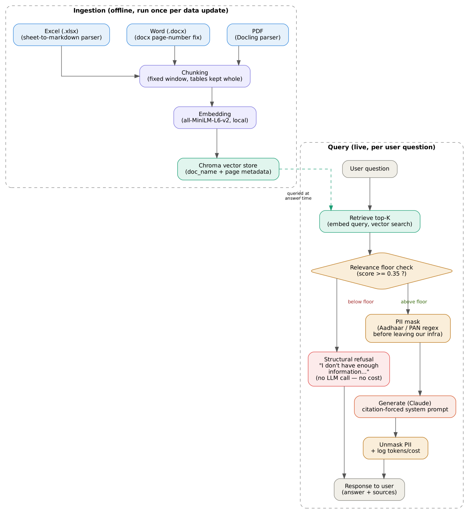

# Grounded RAG Chatbot over Financial Filings

A retrieval-augmented chatbot that answers questions **only** from a provided
set of financial documents — PDF, Word, and Excel filings — and explicitly
refuses to answer when the documents don't contain enough information,
rather than guessing. Built as a technical exercise in data engineering and
RAG system design.

**Live demo:** rag-chatbot-demo-7kbicza3x4dejhmn4adarh.streamlit.app

---

## What this is

Given documents from multiple departments/formats (PDF, Word, and Excel),
the brief was to design a pipeline that can:

1. Ingest and structure heterogeneous document formats
2. Make the content searchable and groundable
3. Answer questions strictly from that content, with citations
4. Refuse cleanly when the answer isn't in the documents

## Dataset

Real filings for Silverline Industries Limited, quarter and half-year ended
30 September 2026, supplied directly for this exercise — 5 files across all
three required formats:

| Format | Files |
|---|---|
| **PDF** | Board Meeting Outcome; Auditor's Limited Review Report (Q2/H1 FY2026-27) |
| **Word (.docx)** | Board Meeting Minutes (22 October 2026) |
| **Excel (.xlsx)** | Financial Results (Q2/H1 FY2026-27); CTC Board Resolutions Register & Templates |

154 pages parsed across all five files → 156 chunks after chunking. All
documents present in the vector store is checked on every ingestion run
(see "Evaluation" below).

## Architecture



```
Documents (PDF/DOCX/XLSX)
   │
   ▼
Docling / pandas  ─────  structure-aware parsing: tables kept as tables,
                          not flattened into unreadable number runs.
                          Word files get a page-number fix Docling doesn't
                          apply by default, or ingestion silently drops them.
   │
   ▼
Chunking  ─────────────  fixed-window chunking; markdown tables kept whole
                          rather than split mid-row; every chunk tagged with
                          doc_name + page
   │
   ▼
Embedding  ────────────  all-MiniLM-L6-v2 (local, free, no API cost)
   │
   ▼
Chroma vector store  ──  stores vectors + metadata together
   │
   ▼
Retrieval  ────────────  top-10 vector search (score = 1/(1+distance), on
                          Chroma's default L2 distance — not cosine) +
                          a RELEVANCE FLOOR (0.35): if the best match isn't
                          close enough, the LLM is never even called — the
                          actual mechanism behind "only answer from
                          documents," not just a prompt instruction
   │
   ▼
PII mask  ─────────────  Aadhaar/PAN-shaped numbers in the question are
                          regex-masked before anything reaches Claude's
                          API; unmasked afterward
   │
   ▼
Generation  ───────────  Claude (Anthropic API, raw SDK — no LangChain),
                          system prompt enforces citation + refusal
                          behavior as a second, behavioral layer on top
                          of the structural floor; token usage and cost
                          logged per call
   │
   ▼
Streamlit UI  ─────────  this app
```

**Why a relevance floor and not just a system prompt:** prompt instructions
alone get ignored under pressure (models will often answer from weak context
rather than admit uncertainty). Gating retrieval with a numeric similarity
threshold means the model never sees irrelevant context in the first place —
structural grounding, not just behavioral. The 0.35 threshold is a
reasonable default, not a value tuned against a labeled eval set for this
data (see "Known limitations" below).

**Why the raw Anthropic SDK and not LangChain:** the pipeline is a single
retrieval step and a single generation call — no multi-step agent logic or
tool orchestration, which is what LangChain's abstractions are built for.
Going direct gives full visibility into exactly what's sent to the model
and how the response is parsed, which mattered for two things built
directly around the raw API call: defensive handling of malformed
responses, and PII masking before/after the call.

## Evaluation

There is no independently-verified, labeled ground-truth set for the
Silverline documents (unlike an earlier version of this project, which used
the published FinanceBench benchmark against different source filings — that
accuracy figure does not carry over to this data and isn't quoted here).
What's actually been checked:

- **Document completeness** — every ingestion run confirms all 5 expected
  documents made it into the vector store (156 chunks from 154 pages);
  currently 5/5.
- **Refusal sanity check** — 4 trap questions (a competitor's figures, a
  stock-price prediction, an out-of-scope company, a future acquisition)
  all correctly refuse rather than guess.
- **Reasoning consistency** — a known bug where differently-phrased
  questions over the *same* grounded content got inconsistent answers
  (one correct, one wrongly refused) was found via live testing, fixed via
  a system-prompt addition, and re-verified live.
- **PII guardrail** — live-tested end-to-end on the deployed app with a
  question containing a fake Aadhaar and PAN number: masked before
  reaching Claude, never leaked into the logged question, answer still
  generated correctly.
- **Crash fix** — the `StopIteration` crash hit live during the first demo
  (a malformed API response with no text block) is fixed with defensive
  extraction and a graceful fallback message, not a silent retry.

## Known limitations (stated, not hidden)

- No independently-verified eval set for the Silverline documents yet, so
  no measured accuracy/retrieval-rate figure is claimed for this data.
- Retrieval can return the right document but the wrong page/section on
  longer filings; raising `TOP_K` alone doesn't fix this — the real fix is
  section-aware chunking, not yet implemented.
- No hybrid keyword+embedding search or reranker — pure vector similarity,
  which risks a semantic mismatch on exact figures or identifiers.
- The PII guardrail covers Aadhaar/PAN-shaped numbers via regex; it does
  not yet cover bank account numbers, and a regex is pattern-based, not a
  general-purpose PII detector.

## Running locally

```bash
pip install -r requirements.txt
streamlit run app.py
```

Requires a pre-built `chroma_store/` directory in the same folder (see
the ingestion notebook) and an `ANTHROPIC_API_KEY` set via Streamlit
secrets (`.streamlit/secrets.toml` locally, or the app dashboard when
deployed).

## Tech stack

Python · Docling · Sentence-Transformers · ChromaDB · Anthropic API
(Claude Sonnet) · Streamlit
